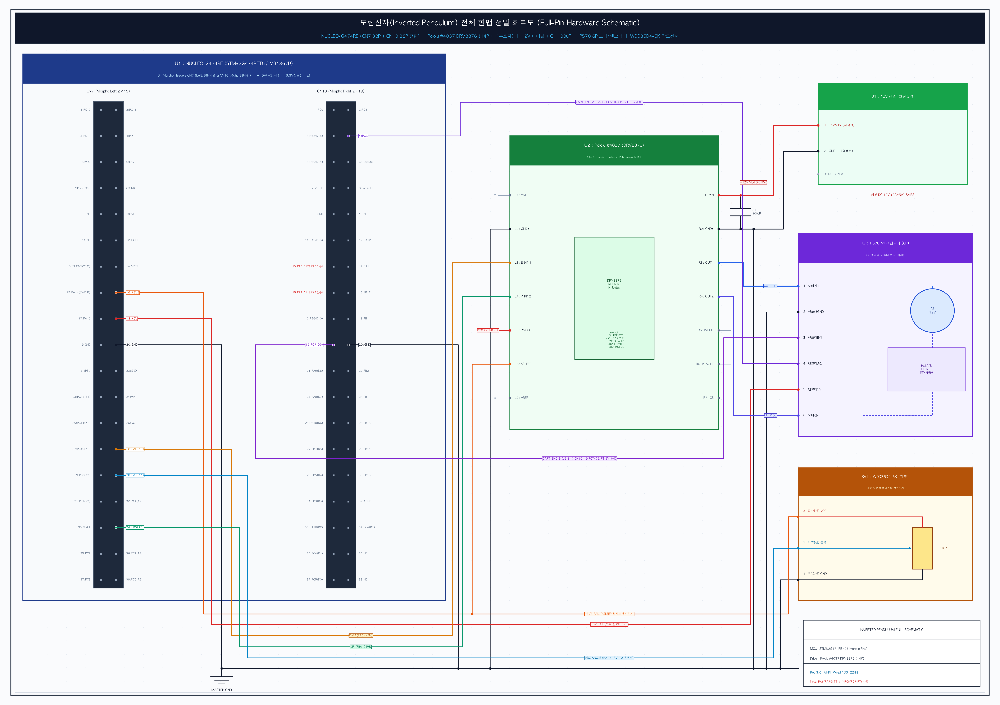

# Inverted Pendulum with STM32G474RE 🚀

NUCLEO-G474RE 보드를 기반으로 하드웨어 저수준(Bare-metal) 레지스터 제어부터 도립진자(Inverted Pendulum) 실시간 밸런싱 제어 시스템까지 단계별로 학습하고 실습할 수 있도록 정리한 오픈 학습 저장소입니다.

---

## 🎯 Target Hardware Specifications (BOM)

| 부품 | 모델명 / 사양 | 주요 역할 |
| :--- | :--- | :--- |
| **MCU 보드** | **STMicroelectronics NUCLEO-G474RE** (`MB1367D`) | STM32G474RET6 (170MHz Cortex-M4F, 512KB Flash, 128KB SRAM), 내장 ST-LINK/V3E VCP |
| **모터 드라이버** | **Pololu #4037** (`TI DRV8876` QFN 캐리어) | 4.5V~37V, 1.1A 연속 / 3.5A 피크 H-Bridge 드라이버 (`PH/EN` 모드 고정) |
| **선형 도립진자 기구물** | **AliExpress IP570** (유효 스트로크 `~385 mm`) | 12V DC 모터 + 5V 홀 직교 엔코더 (`~6,279 counts/385mm`) + 타이밍 벨트 카트 |
| **진자 각도 센서** | **SENTOP `WDD35D4-5K`** (`5kΩ`, 선형도 `0.1%`) | 360° 기계 회전 도전성 플라스틱 전위차계 (아날로그 `0~3.3V` $\rightarrow$ `PA1` ADC) |
| **외부 전원** | **DC 12V (2A~5A) SMPS / 배터리** | 모터 구동 주전원 + `100uF/25V` 벌크 커패시터 |

---

## 🔌 전체 핀맵 정밀 회로도 (Full-Pin Schematic)

만능기판 쉴드 실장 기준 전체 핀 연결도입니다. *(G474RE 데이터시트 `DS12288` 기준 `PA6/PA7`은 3.3V 전용 `TT_a` 핀이므로, 5V 엔코더는 **5V 내성 `FT` 핀인 `PC6(CN10-4)`과 `PC7(D9/CN10-19)`**에 연결합니다.)*



- **실물 사진 대조 핀맵**: [docs/images/inverted_pendulum_real_hardware_pinmap.png](docs/images/inverted_pendulum_real_hardware_pinmap.png)
- **NUCLEO-G474RE 공식 헤더 핀맵**:
  - [Arduino 헤더 (`CN5/6/8/9`)](docs/images/nucleo_g474re_arduino_pinout.png) | [ST Morpho 좌측 (`CN7`)](docs/images/nucleo_g474re_cn7_pinout.png) | [ST Morpho 우측 (`CN10`)](docs/images/nucleo_g474re_cn10_pinout.png)

---

## 📚 Curriculum & Learning Roadmap

모든 학습 단계는 원리 분석, 하드웨어 레지스터 구현, 단독 실행 전체 코드(`main.c`), 실습 검증 결과가 `docs/` 디렉토리에 마크다운으로 상세히 기록됩니다.

| 단계 | 토픽 | 핵심 내용 | 문서 링크 | Linear Issue | 상태 |
| :---: | :--- | :--- | :--- | :---: | :---: |
| **00** | **Environment Setup** | STM32CubeIDE 2.0 설치 및 ST-LINK 연결/트러블슈팅 | [docs/00_environment_setup.md](docs/00_environment_setup.md) | [CH-5](https://linear.app/ch-cho/issue/CH-5) | ✅ 완료 |
| **01** | **Bare-metal LED Blink** | RCC 클럭 제어, GPIO MODER/ODR 레지스터 직접 제어 | [docs/01_baremetal_blink.md](docs/01_baremetal_blink.md) | [CH-5](https://linear.app/ch-cho/issue/CH-5) | ✅ 완료 |
| **02** | **GPIO EXTI** | NVIC 및 EXTI 컨트롤러를 활용한 하드웨어 외부 인터럽트 (버튼 입력) | [docs/02_gpio_exti.md](docs/02_gpio_exti.md) | [CH-6](https://linear.app/ch-cho/issue/CH-6) | ✅ 완료 |
| **03** | **UART Printf** | USART2 VCP 시리얼 통신 및 `printf` 리디렉션을 통한 모니터링 | [docs/03_uart_printf.md](docs/03_uart_printf.md) | [CH-7](https://linear.app/ch-cho/issue/CH-7) | ✅ 완료 |
| **04** | **Timer TimeBase** | 1ms(1kHz) 고정 주기 타이머 인터럽트를 통한 실시간 제어 루프 | [docs/04_timer_timebase.md](docs/04_timer_timebase.md) | [CH-8](https://linear.app/ch-cho/issue/CH-8) | ✅ 완료 |
| **05** | **Timer PWM** | TIM2 20kHz 무소음 PWM, Pololu #4037 H-Bridge 정/역회전, USART2 키보드 원격 조종 | [docs/05_timer_pwm.md](docs/05_timer_pwm.md) | [CH-9](https://linear.app/ch-cho/issue/CH-9) | ✅ 완료 |
| **06** | **Timer Encoder & ADC** | `TIM3` 4체배 직교 엔코더(PC6/PC7, FT) 거리·속도 계산 & `ADC1` 각도 캘리브레이션 | [docs/06_timer_encoder.md](docs/06_timer_encoder.md) | [CH-10](https://linear.app/ch-cho/issue/CH-10) | 🔄 진행중 |
| **07** | **Pendulum Control** | 도립진자 비선형 모델링, 선형화, PID 및 LQR 상태 피드백 제어 | [docs/07_pendulum_control.md](docs/07_pendulum_control.md) | [CH-11](https://linear.app/ch-cho/issue/CH-11) | ⏳ 예정 |

---

## 💻 Quick Start (실습 및 시리얼 확인)

1. `firmware/G474RE_Blink/` 프로젝트를 **STM32CubeIDE**로 열어 빌드 및 Flash합니다.
   *(또는 원하는 이전 단계를 연습하고 싶다면 해당 `docs/0X_*.md` 문서 하단의 전체 `main.c` 코드를 복사해 붙여넣으시면 바로 동작합니다.)*
2. Mac 터미널에서 ST-LINK 가상 시리얼 포트에 연결합니다 (`115200 bps`):
   ```bash
   screen /dev/cu.usbmodem* 115200
   ```
   *(종료 단축키: `Ctrl + A` $\rightarrow$ `k` $\rightarrow$ `y`)*

---

## 🔬 Deep Dive & Technical Notes
데이터시트 및 하드웨어 아키텍처 심층 분석 문서 목록입니다.
- **[Stop 0 Mode & EXTI 상호작용 심층 분석](docs/deep_dive_stop0_low_power.md)**: Cortex-M4 Deep-sleep, Main Regulator, 자율 주변장치(Autonomous Peripheral) 동작 원리 및 펜딩 플래그(`EXTI_PR1`) 클리어 규칙

---

## 🛠 Project Management
이 프로젝트의 이슈 추적 및 마일스톤 관리는 **[Linear](https://linear.app)**를 통해 체계적으로 관리됩니다.
- **Linear Project**: [Inverted Pendulum (도립진자)](https://linear.app/ch-cho/project/inverted-pendulum-도립진자-6b3441480def)
- **Team**: `CH Cho (CH)`

---

## 📂 Repository Structure
```text
InvertedPendulum/
├── README.md                            # 전체 프로젝트 로드맵, BOM, 회로도 개요
├── .gitignore                           # 빌드 산출물 및 임베디드 아티팩트 제외
├── docs/                                # 단계별 튜토리얼 및 이론/트러블슈팅 기록
│   ├── 00_environment_setup.md
│   ├── 01_baremetal_blink.md
│   ├── 02_gpio_exti.md
│   ├── 03_uart_printf.md
│   ├── 04_timer_timebase.md
│   ├── 05_timer_pwm.md                  # Step 05-1 (1kHz) + Step 05-2 (20kHz & DRV8876)
│   ├── 06_timer_encoder.md              # Step 06 (TIM3 4x 엔코더, ADC1 각도, Soft Limit)
│   ├── deep_dive_stop0_low_power.md
│   ├── images/                          # 검증 완료된 회로도 및 실물/데이터시트 핀맵
│   └── ST_manuals/                      # STM32G4 공식 매뉴얼 (RM0440, DS12288, UM2505 등)
└── firmware/                            # STM32 펌웨어 소스 코드 (현재 단계 기준 최신 동기화)
    └── G474RE_Blink/                    # STM32CubeIDE 프로젝트 (Src/main.c)
```
